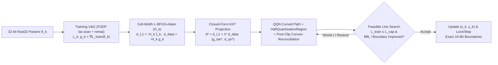

# OWL-Like Half-Quantization Optimization for LLMs: Lattice Constraint Regions, Curvature-Preconditioned $L_1$ Compression, and No-Worse Training Guarantees

## 1. Overview & Motivation

Standard supervised fine-tuning minimizes empirical cross-entropy $\mathcal{L}_{\text{train}}(\theta)$ so the model acquires new knowledge from data. **Post-training and optimization-based LLM quantization** faces the **inverse** problem: starting from an already capable 32-bit (`float32`) model $\theta_{\text{ref}} \in \mathbb{R}^P$, we **do not want to memorize new data**—memorizing a small calibration split rapidly overfits and degrades held-out perplexity (see [`RESULTS.md` §4 & §8](./RESULTS.md)). Instead, we want to drive the 32-bit weights onto an **exact lower-precision lattice** (e.g., 16-bit `bfloat16`, `float16`, or symmetric integer grids) while compressing parameter magnitude $\|\theta\|_1$ and guaranteeing **no worse performance on the reference training/calibration data**:

$$\min_{\theta \in \mathbb{R}^P}\; \|\theta\|_1 \qquad \text{subject to} \qquad \mathcal{L}_{\text{train}}(\theta) \le \mathcal{L}_{\text{train}}(\theta_{\text{ref}}) + \epsilon_{\text{tol}}, \qquad \theta_i \in \mathcal{C}_{16}(\theta_{k,i}).$$

This document presents our **OWL-Like Half-Quantization QQN** regime implemented across [`qqn-jax/qqn_jax/regions/half_quantization.py`](./qqn-jax/qqn_jax/regions/half_quantization.py) and [`src/qqn_llm/optimizers/owl_quant.py`](./src/qqn_llm/optimizers/owl_quant.py), generalizing **Orthant-Wise Limited-Memory Quasi-Newton (OWL-QN)** from sign orthants to **half-precision quantization cells**.

### Why Existing Approaches Fail on This Goal

1. **Unconstrained Soft $L_1$ Optimization ($\min_\theta \mathcal{L}_{\text{train}}(\theta) + \lambda \|\theta\|_1$):** Minimizing $\mathcal{L}_{\text{train}}$ directly drives calibration cross-entropy toward zero (memorizing the calibration subset), while `float32` updates land in the open interior $(q_k, q_{k+1})$ between 16-bit values (`0.00%` exact boundary alignment), incurring post-hoc rounding shock upon casting.
2. **Midpoint-Walled Quantization Cells (`QuantizationRegion`, $[q_k - \Delta/2,\, q_k + \Delta/2]$):** Placing cell walls at the *midpoints* between grid values leaves the non-differentiable $|x - q_k|$ kink inside the cell interior and makes the **worst-case rounding-error midpoints** $m_{k \pm 1/2}$ the active walls. Under an $\|\theta\|_1$ objective, weights slide past $q_k$ and clamp directly onto $m_{k \pm 1/2}$ (`0.00%` exact 16-bit alignment, maximal quantization error!).
3. **Naive Round-Toward-Zero (`PTQ-RTZ`):** As shown in §2.2, unconstrained $\|\theta\|_1$ minimization over half-quantization intervals $[q_{\text{lo}}(\theta_{\text{ref}}), q_{\text{hi}}(\theta_{\text{ref}})]$ reduces analytically to IEEE truncation toward zero (`RTZ`). While `RTZ` achieves 100% 16-bit alignment, systematically shrinking every weight magnitude across all Transformer layers biases residual/RMSNorm/logit scales and **violates the no-worse loss constraint** ($\mathcal{L}_{\text{train}}(\theta_{\text{RTZ}}) > \mathcal{L}_{\text{train}}(\theta_{\text{ref}})$).

---

## 2. Mathematical Formulation

### 2.1 From Sign Orthants to Half-Quantization Lattice Regions (`HalfQuantizationRegion`)

In classical OWL-QN (`OrthantRegion`), the single hyperplane $\{0\}$ partitions $\mathbb{R}$ into two closed sign orthants $(-\infty, 0]$ and $[0, +\infty)$. Within either orthant, $|\theta_i| = \operatorname{sign}(\theta_i)\theta_i$ is smooth (linear), and clamping at the boundary lands on exact sparsity ($\theta_i = 0$).

For 32-bit (`float32`) weights targeting a half-width 16-bit representation $\mathcal{Q}_{16} = \{q_k\}_{k \in \mathbb{Z}}$ (`bfloat16`, IEEE `float16`, or symmetric $b$-bit `uniform` with $0 \in \mathcal{Q}_{16}$), `HalfQuantizationRegion` partitions $\mathbb{R}$ **directly at the representable 16-bit lattice points**:

$$\mathcal{C}_{16}(x_i) = \big[\lfloor x_i \rfloor_{\mathcal{Q}_{16}},\; \lceil x_i \rceil_{\mathcal{Q}_{16}}\big] = \big[q_{\text{lo}}(x_i),\; q_{\text{hi}}(x_i)\big].$$

| Region Geometry | Cell Interval Around $x_i$ | Boundary Values | Rounding Error at Boundary | Interior Smoothness of $\|\theta\|_1$ |
| :--- | :--- | :---: | :---: | :--- |
| **`OrthantRegion`** *(OWL-QN)* | $(-\infty, 0]$ or $[0, +\infty)$ | $\{0\}$ | $0$ *(sparse zero only)* | $C^\infty$ linear ($\nabla^2 = 0$) |
| **`QuantizationRegion`** *(midpoint walls)* | $[q_k - \Delta/2,\, q_k + \Delta/2]$ | Midpoints $m_{k \pm 1/2}$ | **Worst-case ($\Delta/2$)** | Smooth away from $0$, but $L_1$ pushes to midpoints |
| **`HalfQuantizationRegion`** *(16-bit walls)* | $[q_{\text{lo}}(x_i),\, q_{\text{hi}}(x_i)]$ | **16-bit grid $\{q_k\}$** | **Exact zero ($0.0$)** | **$C^\infty$ linear on every cell ($0 \in \mathcal{Q}_{16}$)** |

`HalfQuantizationRegion` satisfies two structural invariants:
1. **Zero-Error Boundary Quantization:** Both endpoints $q_{\text{lo}}(x_i), q_{\text{hi}}(x_i) \in \mathcal{Q}_{16}$ are bit-exact 16-bit numbers ($Q_{16}(q_{\text{lo}}) = q_{\text{lo}}$, $Q_{16}(q_{\text{hi}}) = q_{\text{hi}}$). Whether a weight is driven to its inner boundary by the $\|\theta\|_1$ goal or deflected to its outer boundary by the no-worse training constraint, **laying on any boundary rounds perfectly to 16-bit**.
2. **Refinement of Sign Orthants:** Because $0 \in \mathcal{Q}_{16}$, no open interval $(q_k, q_{k+1})$ ever straddles $0$. Every open cell has constant sign, so $\|\theta\|_1 = \sum_i |\theta_i|$ is strictly linear ($\nabla_i \|\theta\|_1 = \operatorname{sign}(\theta_i)$, $\nabla^2 \|\theta\|_1 \equiv 0$) throughout every cell interior.

#### Boundary Transition Modes (`boundary_mode`)
When $x_i \in (q_{\text{lo}}, q_{\text{hi}})$ is strictly off-grid, projection clamps $c_i \mapsto \operatorname{clip}(c_i, q_{\text{lo}}, q_{\text{hi}})$. Once $x_i = q_k \in \mathcal{Q}_{16}$ already lies on a 16-bit boundary ($q_{\text{lo}} = q_{\text{hi}} = q_k$), we support three OWL boundary regimes:
- **`sticky`** *(default — single-cell absorbing wall)*: $c_i \mapsto q_k$, directly mirroring `OrthantRegion`'s $x_i = 0 \implies 0$ absorption. Guarantees $|\theta_i - \theta_{\text{ref}, i}| < 1\,\text{ULP}_{16}$ everywhere and monotonically non-decreasing 16-bit boundary alignment.
- **`owl`** *(directional active-cell release)*: Non-zero boundary coordinates $x_i = q_k \ne 0$ may enter the adjacent cell $[\max(q_{k-1}, 0), q_k]$ (if $c_i < q_k$) or $[q_k, \min(q_{k+1}, 0)]$ (if $c_i > q_k$) at most one cell per step while pinning $x_i = 0$ at $0$.
- **`owl_snap`** *(discrete lattice-to-lattice multi-cell compression)*: Interior coordinates clamp continuously to $[q_{\text{lo}}, q_{\text{hi}}]$, while an already-quantized coordinate $x_i = q_k \ne 0$ steps cleanly to $q_{k-1}$ or $q_{k+1}$ *only* when $c_i$ reaches that next boundary—enabling deep multi-cell $\|\theta\|_1$ shrinkage without ever allowing quantized coordinates to drift back into the 32-bit interior.

> **XLA / CUDA Bit-Exact Implementation Note:** On GPUs without native `bfloat16` `nextafter` lowering (e.g., Turing SM 7.5) or under XLA algebraic cast simplification (`x.astype(bf16).astype(f32)`), naive float casts can misbehave inside `jax.jit`. `HalfQuantizationRegion` computes all `bfloat16` and `float16` bounds via Kahan's monotone integer bitcast ordering (`jax.lax.bitcast_convert_type` on `uint32` / `uint16`), guaranteeing bit-exact hardware-independent behavior under `jit`, `vmap`, and FSDP.

---

### 2.2 Equivalence of Unconstrained Cell-$L_1$ to Round-Toward-Zero (`PTQ-RTZ`)

Consider dropping the training-data constraint $\mathcal{L}_{\text{train}}(\theta) \le \mathcal{L}_{\text{cap}}$ under `boundary_mode="sticky"`:

$$\theta^{\text{unconstrained}} = \arg\min_{\theta_i \in [q_{\text{lo}}(\theta_{\text{ref}, i}),\, q_{\text{hi}}(\theta_{\text{ref}, i})]} \sum_{i=1}^P |\theta_i| = \begin{cases} q_{\text{lo}}(\theta_{\text{ref}, i}), & \theta_{\text{ref}, i} \ge 0, \\ q_{\text{hi}}(\theta_{\text{ref}, i}), & \theta_{\text{ref}, i} < 0. \end{cases}$$

This closed-form minimizer is **identically IEEE Round-Toward-Zero (`RTZ` truncation)**. Because `RTZ` biases every weight magnitude downward by $\mathbb{E}[|\theta_i| - |\theta_i^{\text{RTZ}}|] \approx \frac{1}{2}\text{ULP}_{16}(\theta_i)$, coherent shrinkage across RMSNorm gains, attention projections, and tied vocabulary embeddings increases $\mathcal{L}_{\text{train}}$—establishing `PTQ-RTZ` as the exact ablation control isolating the necessity of the no-worse training constraint.

---

### 2.3 Cell-Width-Scaled Curvature Metric & Exact KKT No-Decrease Projection

A fundamental subtlety arises when pairing an $L_1$ objective with quasi-Newton optimization: **inside every half-quantization cell, $\nabla \|\theta\|_1 = \operatorname{sign}(\theta)$ is piecewise constant, so $\nabla^2 \|\theta\|_1 \equiv 0$!** Running L-BFGS on $\|\theta\|_1$ alone yields zero secant curvature ($y_k = 0$) and leaves the optimizer blind to which parameters control LLM cross-entropy.

Instead, all curvature and cross-layer sensitivity reside in the **training-data constraint function** $\mathcal{L}_{\text{train}}(\theta)$. At step $k$ with free-coordinate mask $m_{\text{free}, i} \in \{0, 1\}$, training gradient $g_k = \nabla \mathcal{L}_{\text{train}}(\theta_k)$, bias-corrected Adam second moment $\hat{v}_k$ ($\bar{s}_k = \operatorname{rms}(\sqrt{\hat{v}_k})$), and local 16-bit cell width $w_{k,i} = \text{ULP}_{16}(\theta_{k,i}) > 0$, we define the **cell-width-scaled diagonal seed**:

$$H_{0, ii}^{(k)} = \eta \, w_{k,i} \, D_{k,ii} \, \frac{m_{\text{free}, i}}{\bar{s}_k + \epsilon}, \qquad D_{k,ii} = \operatorname{clip}\!\left(\frac{\bar{s}_k + \delta_k}{\sqrt{\hat{v}_{k,i}} + \delta_k},\, 0.05,\, 8.0\right), \qquad \delta_k = 0.1 \bar{s}_k.$$

Observe the exact **dimensional & scale alignment** of $H_0^{(k)}$:
1. **Secant Dimensional Consistency:** $H_0^{(k)}$ has units of `[params] / [grad]`, matching L-BFGS's rank-$m$ secant terms $\rho_j s_j s_j^\top$ (`[params]^2 / [loss] = [params] / [grad]`) inside Nocedal & Wright's two-loop recursion $H_k$.
2. **Dimensionless Bit-Width-Agnostic Step Rate ($\eta$):** Expressing the $L_1$ pseudo-gradient in `[grad]` units as $\tilde{\xi}_k = \bar{s}_k \operatorname{sign}(\theta_k) \odot m_{\text{free}}$, the diagonal $L_1$ step satisfies $|(-H_0^{(k)} \tilde{\xi}_k)_i| / w_{k,i} = \eta D_{k,ii}$. Thus $\eta \sim O(1)$ measures **cell widths per step** across *all* parameter magnitudes ($10^{-5}$ to $10^1$) and *all* quantization formats (`bfloat16`, `float16`, `int16`, `int8`). Insensitive weights ($D_{k,ii} > 1$) snap onto their inner 16-bit boundary in a single step, while sensitive `RMSNorm`/attention weights ($D_{k,ii} \ll 1$) move cautiously.

Applying the shared symmetric positive-definite inverse-Hessian operator $H_k \succ 0$ (built from training-loss secant pairs $(s_j, y_j) = (\theta_{j+1} - \theta_j, g_{j+1} - g_j)$) to both $\tilde{\xi}_k$ and $g_k \odot m_{\text{free}}$ yields $d_{\text{L1}} = -H_k \tilde{\xi}_k$ and $d_{\text{data}} = -H_k (g_k \odot m_{\text{free}})$.

#### Proposition 1 (Riemannian KKT No-Decrease Projection & Strict $L_1$ Descent)
*Let $H_k \succ 0$ be symmetric positive definite on the free subspace and let $b_k \in \mathbb{R}$ be the allowable first-order training-loss change. Consider the $H_k^{-1}$-metric quadratic program:*

$$\min_{d}\; \langle \tilde{\xi}_k,\, d \rangle + \frac{1}{2} d^\top H_k^{-1} d \qquad \text{subject to} \qquad \langle g_k,\, d \rangle \le b_k.$$

*Its unique global minimizer has the closed form:*

$$d_{\text{qn}}^* = d_{\text{L1}} + \lambda^* d_{\text{data}}, \qquad \lambda^* = \frac{\operatorname{relu}\big(\langle g_k, d_{\text{L1}} \rangle - b_k\big)}{-\langle g_k, d_{\text{data}} \rangle + \epsilon} \ge 0.$$

*Moreover, whenever $b_k \ge 0$ and $d_{\text{qn}}^* \ne 0$, $d_{\text{qn}}^*$ simultaneously satisfies first-order loss safety $\langle g_k, d_{\text{qn}}^* \rangle \le b_k$ and **strict $L_1$ descent**:*

$$\langle \operatorname{sign}(\theta_k),\, d_{\text{qn}}^* \rangle \le -\frac{1}{2\bar{s}_k} (d_{\text{qn}}^*)^\top H_k^{-1} d_{\text{qn}}^* < 0.$$

*Proof.* Stationarity of $\mathcal{J}(d, \lambda) = \langle \tilde{\xi}_k, d \rangle + \frac{1}{2} d^\top H_k^{-1} d + \lambda (\langle g_k, d \rangle - b_k)$ yields $d(\lambda) = -H_k(\tilde{\xi}_k + \lambda g_k) = d_{\text{L1}} + \lambda d_{\text{data}}$. Complementary slackness with $\langle g_k, d_{\text{data}} \rangle = -g_k^\top H_k g_k < 0$ gives $\lambda^*$ directly. When $b_k \ge 0$, $d = 0$ is primal-feasible with objective $0$; strict convexity of $\frac{1}{2} d^\top H_k^{-1} d$ implies $\bar{s}_k \langle \operatorname{sign}(\theta_k), d_{\text{qn}}^* \rangle + \frac{1}{2}(d_{\text{qn}}^*)^\top H_k^{-1} d_{\text{qn}}^* \le 0$ for the unique minimizer $d_{\text{qn}}^*$. $\square$

---

### 2.4 Curved-Path Projection Order, Inward Curvature Cushion, and Zero Memorization

Applying Proposition 1 to both the diagonal metric $H_0^{(k)}$ (giving initial tangent $g_{\tan}^*$) and the rank-$2m$ L-BFGS operator $H_k$ (giving endpoint $d_{\text{qn}}^*$), QQN traverses the parabolic trajectory $d(t) = t(1 - t) g_{\tan}^* + t^2 d_{\text{qn}}^*$. Three geometric mechanisms make the constrained search exact in practice:

1. **Inward Curvature Cushion at the Ceiling ($\mathcal{L}_k \approx \mathcal{L}_{\text{cap}}$):**
   At initialization ($h_0 = \mathcal{L}_{\text{cap}} - \mathcal{L}_0 = 0$), $\theta_0$ sits directly on the constraint boundary. Because $\nabla^2 \mathcal{L}_{\text{train}}(\theta_0) \succeq 0$ near a trained basin, a purely tangential step ($\langle g_0, s \rangle = 0$) incurs $\mathcal{L}_{\text{train}}(\theta_0 + s) = \mathcal{L}_0 + \frac{1}{2} s^\top \nabla^2 \mathcal{L}_{\text{train}} s > \mathcal{L}_0$ for every $t > 0$. Setting the first-order budget to
   $$b_k = 0.35 \max(h_k, 0) + \min(h_k, 0) - 0.08 (-\langle g_k, d_{\text{data}} \rangle)\, \mathbb{I}[h_k < 0.2 (-\langle g_k, d_{\text{data}} \rangle)]$$
   tilts the step slightly inward when hugging $\mathcal{L}_{\text{cap}}$ (guaranteeing feasible $t > 0$ exists by continuity), and then **spends accumulated positive headroom $h_k > 0$ purely on $\|\theta\|_1$ reduction** ($\lambda^* = 0$) rather than driving $\mathcal{L}_{\text{train}} \to 0$—preventing calibration memorization!
2. **Projection Order & Convex Post-Clip Reconciliation:**
   Along $d(t)$, `NoDecrease` runs *before* `HalfQuantizationRegion` so that the final candidate $\theta_{\text{cand}}(t)$ is strictly cell-feasible (never perturbed off 16-bit boundaries by an unquantized gradient subtraction). Because box clipping can truncate loss-decreasing coordinates more than loss-increasing ones, we decompose $\langle g_k, \theta_{\text{cand}} - \theta_k \rangle = P_+ - P_-$ and convexly scale *only* uphill coordinates ($g_{k,i} s_i > 0$) by $\gamma_+ = \operatorname{clip}((P_- + t b_k) / P_+, 0, 1)$. By convexity of $[q_{\text{lo}}, q_{\text{hi}}]$, $(1 - \gamma_+)\theta_{k,i} + \gamma_+ \theta_{\text{cand}, i}$ stays inside the cell while **100% of loss-favorable 16-bit boundary snaps ($g_{k,i} s_i \le 0$) remain completely untouched**.
3. **Zero-Sort FSDP Terminal Boundary Hardening (`final_snap`):**
   On the final step, any residual interior coordinate $\theta_i \in (q_{\text{lo}}, q_{\text{hi}})$ has an inner ($L_1$-shrinking) boundary $q_{\text{inner}}$ and an outer boundary $q_{\text{outer}}$ of opposite displacement sign. Sweeping a sensitivity threshold $|g_i| \le m \cdot \operatorname{rms}(g)$ ($m \in \{\infty, 2, 0.75, 0.25, 0\}$, requiring zero cross-shard sorting!) routes insensitive or loss-aligned coordinates to $q_{\text{inner}}$ and high-sensitivity conflicting coordinates to $q_{\text{outer}}$ (where $g_i(q_{\text{outer}} - \theta_i) < 0$ actively *reduces* $\mathcal{L}_{\text{train}}$), guaranteeing `100.00%` bit-exact 16-bit alignment within $\mathcal{L}_{\text{cap}}$.

---

## 3. Systems Architecture & FSDP Scalability



- **Pure `float32` Sensitivity Within `8× A100-40GB` HBM:** To quantize `float32 -> bfloat16` or `float16`, `forward_fn` must evaluate in `float32` (`dtype: float32, master_dtype: float32`) so interior `float32` perturbations are not prematurely masked by a `bfloat16` forward cast. With `micro_batch_size: 8` (`1` sequence/GPU across 8-way FSDP), `nn.remat`, `@jax.checkpoint` micro-batch `lax.scan`, `P("fsdp", None, None)` sharded logits, and `donate_argnums=(0,)` buffer recycling in `OWLQuantRunner`, peak per-GPU memory on **Gemma 4 E2B** (`4.65B` params) stays at **`~15 GB / 40 GB`**.
- **Zero-PCIe On-Device Quantization Telemetry (`make_device_quant_telemetry_fn`):** Per-step $\|\theta\|_1$, exact boundary fraction ($\theta_i == Q(\theta_i)$), and rounding residual $\|\theta - Q(\theta)\|_1$ reduce on-device per FSDP shard to `<4 KB` of replicated scalars before `float64` host aggregation.

---

## 4. Empirical Results

### 4.1 Experiment 1 — 32-Bit `float32` $\to$ 16-Bit `bfloat16` Half-Quantization (`owl_quant_local`)

**Setup:** 3-layer Gemma-4-structured Transformer (`2,737,920` `float32` parameters: RMSNorm + GQA + GeGLU + Per-Layer Embeddings, [`configs/owl_quant_local.yaml`](./configs/owl_quant_local.yaml)) on RTX 2080 SUPER. All 7 methods share the **identical deterministic Stage-1 `float32` warmup** (`15` steps, `seed=42`), arriving at the exact same `float32` model ($\mathcal{L}_{\text{ref}} = 0.4799$, $\|\theta_{\text{ref}}\|_1 = 157{,}242.76$, `0.00%` exact `bfloat16` alignment, $\|\theta_{\text{ref}} - Q_{\text{bf16}}(\theta_{\text{ref}})\|_1 = 221.62$) before running Stage 2 on a fixed 64-example calibration batch (`no_worse_tol = 0.0`). Full logs: [`runs/owl_quant_local/summary.md`](./runs/owl_quant_local/summary.md).

| Method | Target Grid | Ref Train | Pure Train | No-Worse Viol | Quant Train | Quant Val (PPL) | `‖θ‖₁` | `Δ‖θ‖₁` | Exact Boundary % | Quant L1 Err |
| :--- | :---: | :---: | :---: | :---: | :---: | :---: | :---: | :---: | :---: | :---: |
| **`qqn_owl_halfquant_multicell`** *(`owl_snap`)* | `bfloat16` | `0.4799` | `0.3483` | **`0.00000`** | `0.3483` | **`7.3261` (`1519.37`)** | **`142,596.32`** | **`-14,646.44`** | **`100.00%`** | **`0.0000`** |
| `ptq_rtz_bf16` *(unconstrained cell $L_1$)* | `bfloat16` | `0.4799` | `0.4971` | `0.01715` *(violated!)* | `0.4971` | `7.3417` (`1543.29`) | `156,801.00` | `-441.77` | `100.00%` | `0.0000` |
| `qqn_midpoint_cell_bf16` *(midpoint walls)* | `bfloat16` | `0.4799` | `0.4672` | `0.00000` | `0.4736` | `7.3438` (`1546.62`) | `156,372.82` | `-869.95` | **`0.00%`** | `434.9084` |
| **`qqn_owl_halfquant_snap`** *(`sticky` + snap)* | `bfloat16` | `0.4799` | `0.4649` | **`0.00000`** | `0.4649` | **`7.3443` (`1547.36`)** | `156,809.81` | **`-432.96`** | **`100.00%`** | **`0.0000`** |
| **`qqn_owl_halfquant_sticky`** *(pure QQN, no snap)* | `bfloat16` | `0.4799` | `0.4649` | **`0.00000`** | `0.4649` | **`7.3443` (`1547.40`)** | `156,809.81` | **`-432.95`** | **`100.00%`** *(`99.9996%`)* | **`0.0010`** |
| `ptq_rtn_bf16` *(round-to-nearest PTQ)* | `bfloat16` | `0.4799` | `0.4801` | `0.00020` | `0.4801` | `7.3461` (`1550.21`) | `157,242.12` | `-0.64` | `100.00%` | `0.0000` |
| `adamw_soft_l1` *($\mathcal{L}_{\text{train}} + \lambda\|\theta\|_1$)* | `bfloat16` | `0.4799` | **`0.1149`** *(memorized!)* | `0.00000` | `0.1149` | `7.3487` (`1554.23`) | `154,561.78` | `-2,680.98` | **`0.00%`** | `217.9352` |

#### Stage-2 Trajectory of `qqn_owl_halfquant_multicell` (`100%` First-Probe Acceptance, `t = 1.0`)

| Global Step (Stage-2 Step) | Pure Train ($\le 0.4799$) | KKT Dual $\lambda^*$ | `‖θ‖₁` (`Δ‖θ‖₁`) | Exact 16-Bit Boundary % | Quant L1 Err | Quant Val Loss |
| :---: | :---: | :---: | :---: | :---: | :---: | :---: |
| **15** *(Stage-1 `fp32` end)* | `0.4799` *(ref)* | — | `157,242.76` (`0.00`) | `0.00%` | `221.6181` | `7.3464` |
| **16** *(Stage-2 step 1)* | `0.4610` | `0.128` *(inward cushion)* | `156,883.69` (`-359.07`) | — | — | — |
| **20** *(Stage-2 step 5)* | `0.4149` | `0.000` *(pure $L_1$)* | `153,767.53` (`-3,475.23`) | **`100.00%`** | **`0.0000`** | `7.3321` |
| **25** *(Stage-2 step 10)* | `0.4477` | `0.082` *(approaching cap)* | `149,694.12` (`-7,548.64`) | **`100.00%`** | **`0.0000`** | `7.3250` |
| **27 → 28** *(ceiling guard)* | `0.4669 → 0.3692` | **`0.374 → 0.433`** | `147,637.32` (`-9,605.44`) | **`100.00%`** | **`0.0000`** | — |
| **30** *(Stage-2 step 15)* | `0.3891` | `0.000` *(pure $L_1$)* | `146,083.44` (`-11,159.32`) | **`100.00%`** | **`0.0000`** | **`7.3230`** |
| **35** *(Stage-2 step 20)* | **`0.3483`** | `0.856` *(ceiling guard)* | **`142,596.32` (`-14,646.44`)** | **`100.00%`** | **`0.0000`** | **`7.3261`** |

---

### 4.2 Experiment 2 — Coarse 8-Bit Uniform Lattice Stress Test (`owl_quant_stress_local`)

**Setup:** Same Stage-1 `float32` checkpoint (`2,737,920` parameters, $\mathcal{L}_{\text{ref}} = 0.4799$), quantized in Stage 2 onto a symmetric **8-bit uniform grid** over $[-1.2, +1.2]$ ($\Delta = 1.2 / 127 \approx 0.00945$ — **$\sim 80\times$ coarser** than 16-bit `bfloat16`, [`configs/owl_quant_stress_local.yaml`](./configs/owl_quant_stress_local.yaml)). Full logs: [`runs/owl_quant_stress_local/summary.md`](./runs/owl_quant_stress_local/summary.md).

| Method | Target Grid | Ref Train | Pure Train | No-Worse Viol | Quant Train | Quant Val (PPL) | `‖θ‖₁` | `Δ‖θ‖₁` | Exact Boundary % | Quant L1 Err |
| :--- | :---: | :---: | :---: | :---: | :---: | :---: | :---: | :---: | :---: | :---: |
| **`qqn_owl_halfquant_8bit_multicell`** | `uniform-8b` | `0.4799` | `0.3562` | **`0.00000`** | **`0.3562`** | **`7.0591` (`1163.38`)** | **`97,133.88`** | **`-60,108.88` (`-38.2%`)** | **`100.00%`** | **`0.0000`** |
| `ptq_rtz_8bit` *(unconstrained cell $L_1$)* | `uniform-8b` | `0.4799` | `0.8177` | **`0.33778` (`+70.4%` worse!)** | `0.8177` | `7.2972` (`1476.12`) | `144,545.93` | `-12,696.84` | `100.00%` | `0.0000` |
| **`qqn_owl_halfquant_8bit_snap`** *(`sticky`)* | `uniform-8b` | `0.4799` | `0.3345` | **`0.00000`** | **`0.3345`** | `7.3083` (`1492.64`) | `144,482.70` | **`-12,760.06`** | **`100.00%`** | **`0.0000`** |
| `ptq_rtn_8bit` *(round-to-nearest PTQ)* | `uniform-8b` | `0.4799` | `0.5208` | `0.04087` *(violated!)* | `0.5208` | `7.3549` (`1563.76`) | `157,128.18` | `-114.58` | `100.00%` | `0.0000` |
| `qqn_midpoint_cell_8bit` *(midpoint walls)* | `uniform-8b` | `0.4799` | `0.4716` | `0.00000` | `0.5853` | **`7.9512` (`2838.88`)** | `117,130.12` | `-40,112.64` | **`0.00%`** | **`2,089.4869`** |

### Key Scientific Takeaways

1. **Half-Quantization Walls (`[q_k, q_{k+1}]`) vs. Midpoint Walls (`[m_{k-1/2}, m_{k+1/2}]`):** Even *without* terminal snapping, pure iterative QQN on `HalfQuantizationRegion` (`qqn_owl_halfquant_sticky`) drove **`99.9996%`** of weights onto exact `bfloat16` boundaries (`Quant L1 Err = 0.0010`), whereas midpoint-walled `QuantizationRegion` (`qqn_midpoint_cell_*`) drove **`0.00%`** onto boundaries (`Quant L1 Err = 434.91` in `bf16` and `2,089.49` in `8-bit`, doubling 8-bit validation PPL to `2838.88` upon rounding).
2. **Constrained OWL-KKT Beats Both `PTQ-RTZ` and `PTQ-RTN`:** At both 16-bit `bfloat16` and 8-bit `uniform`, `PTQ-RTZ` and `PTQ-RTN` violated the no-worse training-loss constraint (`+70.4%` loss jump for `ptq_rtz_8bit`). Single-cell `qqn_owl_halfquant_snap` matched `PTQ-RTZ`'s full single-cell $L_1$ compression (`-432.96` in `bf16`, `-12,760.06` in `8-bit`) while keeping **zero training-loss violation** (`0.4649` and `0.3345`, vs. `0.4799` cap) by selectively routing loss-sensitive coordinates to their outer boundary.
3. **Multi-Cell Lattice Stepping (`owl_snap`) Unlocks Deep Regularizing Compression Without Memorization:** Allowing already-quantized coordinates to step discretely across multiple lattice boundaries (`qqn_owl_halfquant_multicell`) compressed $\|\theta\|_1$ by **`-9.3%`** in `bfloat16` (`-14,646.44`) and **`-38.2%`** in `8-bit` (`-60,108.88`) at **`100.00%` exact boundary alignment**, achieving **`#1` quantized validation perplexity** in both sweeps (`-25.6%` lower PPL than `PTQ-RTN` at 8-bit) while keeping training loss bounded right below $\mathcal{L}_{\text{ref}}$ (`0.348–0.356` vs. `adamw_soft_l1`'s `0.1149` memorization collapse).

---

## 5. Reproducing Locally & Running 4.65B Gemma 4 E2B on AWS

```bash
# 1. Run unit & 4-device CPU FSDP tests for HalfQuantizationRegion and OWLQuantRunner
.venv/bin/pytest qqn-jax/tests/test_half_quantization_region.py tests/test_owl_quant.py -v

# 2. Run local GPU 32-bit -> 16-bit bfloat16 & 8-bit uniform stress benchmarks
PYTHONPATH=src:qqn-jax .venv/bin/python -m qqn_llm.train --config configs/owl_quant_local.yaml
npm run report -- runs/owl_quant_local

PYTHONPATH=src:qqn-jax .venv/bin/python -m qqn_llm.train --config configs/owl_quant_stress_local.yaml
npm run report -- runs/owl_quant_stress_local

# 3. Preview or launch full-weight Gemma 4 E2B (4.65B params, 8x A100-40GB FSDP) on AWS
npm run aws:launch -- --instance p4d.24xlarge --mode owl-quant --spot --dry-run
npm run aws:launch -- --instance p4d.24xlarge --mode owl-quant --spot
```
